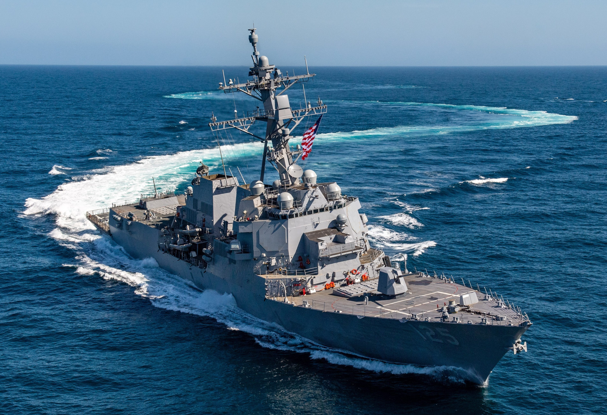
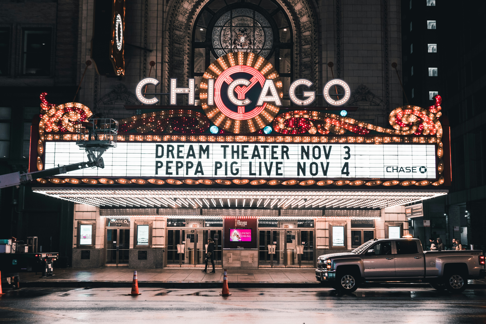

<div align="center">

<h1>🦅 THE UNITED STATES OF AMERICA 🦅</h1>
<h3>🌟 A Cinematic, Data-Backed Love Letter to the Republic 🌟</h3>


<p><em>“One nation under God, indivisible, with liberty and justice for all.”</em></p>

[](https://nextjs.org/)
[](https://www.typescriptlang.org/)
[](https://nextjs.org/docs/app)
[](https://tailwindcss.com/)
[](https://www.framer.com/motion/)
[](#-the-sovereignty-tech-stack)
[](#-the-sovereignty-tech-stack)
[](#-bilingual-localization-engine-enro)

</div>

---

> ⭐️ **THE SOVEREIGN VALUES OF THE REPUBLIC** ⭐️
> 
> | 🔴 **VALOR & STRENGTH** (Red) | ⚪️ **PURITY & INNOCENCE** (White) | 🔵 **VIGILANCE & JUSTICE** (Blue) |
> | :--- | :--- | :--- |
> | **Economy & Innovation**<br>The greatest engine of prosperity in human history ($32.4T GDP). | **Natural Geography**<br>From sea to shining sea, every major climate zone on Earth. | **The Constitution**<br>The oldest written sovereign document still in active authority. |
> | **Military Triad**<br>A global shield for democracy, free seas, and strategic stability. | **National Parks System**<br>85 million acres protected — "America's best idea." | **Democratic Order**<br>Continuous transfers of power through 60 presidential cycles. |

---

## 🏛️ Vision & Platform Philosophy

> 🦅 **A patriotic editorial web experience, not a generic SaaS template.**  
> Built to feel intentional, premium, data-backed, and unmistakably American.

The United States of America platform is engineered as a high-fidelity digital cultural institution. Rather than a marketing site, it operates as an art-directed content platform combining:

- **Museum-Grade Visuals**: High-resolution photography, deep obsidian `#000000` aesthetic, gold accents, and custom typographic hierarchies.
- **Data-First Architecture**: 100% of facts, statistics, and historical records are decoupled from JSX templates and stored in typed registries (`lib/data/*`).
- **Interactive Civics & Simulations**: 236-year interactive Electoral Archive, Euclidean distance Federalism Policy Matcher, 11-Carrier Strike Group real-time vector tracker, and interactive Skyscraper Height Race.
- **Full Bilingual Parity (EN/RO)**: Comprehensive English and Romanian localization supported across both server-rendered content and client-side state islands.
- **Zero CLS & High Performance**: Optimized with Vercel Web Vitals tracking, dynamic viewport scaling, and lazy chart mounting.

---

## 🦅 Gallery of the Republic (Visual Heritage Showcase)

A curated archive of local high-resolution photography illustrating the continental scale, infrastructure marvels, and scientific authority of the United States.

### 🌟 Continental Scale & Infrastructure

<div align="center">
  
  <br />
  <div style="max-width: 550px; text-align: center; margin: 15px auto 35px auto; font-family: 'Georgia', serif; font-size: 13px; line-height: 1.6; color: #A0AEC0;">
    <strong style="color: #C5A059; letter-spacing: 1.5px; font-size: 11px; text-transform: uppercase;">★ "The Shining City on a Hill" ★</strong>
    <br />
    The continental United States illuminated at night from low Earth orbit, representing the immense scale of American prosperity, energy grids, and human achievement.
  </div>
</div>

<div align="center">
  
  <br />
  <div style="max-width: 550px; text-align: center; margin: 15px auto 35px auto; font-family: 'Georgia', serif; font-size: 13px; line-height: 1.6; color: #A0AEC0;">
    <strong style="color: #C5A059; letter-spacing: 1.5px; font-size: 11px; text-transform: uppercase;">★ "Gateway to the Pacific" ★</strong>
    <br />
    The majestic orange span of the Golden Gate Bridge in San Francisco, California, a legendary engineering masterpiece demonstrating the ambition and connectivity of American infrastructure.
  </div>
</div>

<div align="center">
  
  <br />
  <div style="max-width: 550px; text-align: center; margin: 15px auto 35px auto; font-family: 'Georgia', serif; font-size: 13px; line-height: 1.6; color: #A0AEC0;">
    <strong style="color: #C5A059; letter-spacing: 1.5px; font-size: 11px; text-transform: uppercase;">★ "The Spaceship Campus" ★</strong>
    <br />
    Apple Park in Cupertino, California, the architectural pinnacle of Silicon Valley, representing the global leadership of American industrial design, computing technology, and venture capital.
  </div>
</div>

<div align="center">
  
  <br />
  <div style="max-width: 550px; text-align: center; margin: 15px auto 35px auto; font-family: 'Georgia', serif; font-size: 13px; line-height: 1.6; color: #A0AEC0;">
    <strong style="color: #C5A059; letter-spacing: 1.5px; font-size: 11px; text-transform: uppercase;">★ "The Capital of Capital" ★</strong>
    <br />
    The iconic skyline of Manhattan glowing at sunset, representing the unmatched liquidity, trade velocity, and absolute depth of the United States capital markets.
  </div>
</div>

<div align="center">
  
  <br />
  <div style="max-width: 550px; text-align: center; margin: 15px auto 35px auto; font-family: 'Georgia', serif; font-size: 13px; line-height: 1.6; color: #A0AEC0;">
    <strong style="color: #C5A059; letter-spacing: 1.5px; font-size: 11px; text-transform: uppercase;">★ "The Arteries of Commerce" ★</strong>
    <br />
    The multi-level freeway interchanges of Los Angeles, California, illustrating the immense logistical throughput and robust dynamic distribution network of American interstate trade.
  </div>
</div>

<div align="center">
  
  <br />
  <div style="max-width: 550px; text-align: center; margin: 15px auto 35px auto; font-family: 'Georgia', serif; font-size: 13px; line-height: 1.6; color: #A0AEC0;">
    <strong style="color: #C5A059; letter-spacing: 1.5px; font-size: 11px; text-transform: uppercase;">★ "Conquering the Orbital Commons" ★</strong>
    <br />
    A commercial space launch lighting up the Florida sky, representing the private aerospace revolution and the expansion of American technology into Earth orbit and beyond.
  </div>
</div>

<div align="center">
  
  <br />
  <div style="max-width: 550px; text-align: center; margin: 15px auto 35px auto; font-family: 'Georgia', serif; font-size: 13px; line-height: 1.6; color: #A0AEC0;">
    <strong style="color: #C5A059; letter-spacing: 1.5px; font-size: 11px; text-transform: uppercase;">★ "The Sanctuary of the Republic" ★</strong>
    <br />
    The neoclassical dome of the United States Capitol in Washington, D.C., representing the architectural focus and historical continuity of representative democracy.
  </div>
</div>

<div align="center">
  
  <br />
  <div style="max-width: 550px; text-align: center; margin: 15px auto 35px auto; font-family: 'Georgia', serif; font-size: 13px; line-height: 1.6; color: #A0AEC0;">
    <strong style="color: #C5A059; letter-spacing: 1.5px; font-size: 11px; text-transform: uppercase;">★ "Ivy League and Academic Excellence" ★</strong>
    <br />
    The iconic Low Memorial Library at Columbia University in New York, representing the global leadership of American higher education, research output, and intellectual legacy.
  </div>
</div>

<div align="center">
  
  <br />
  <div style="max-width: 550px; text-align: center; margin: 15px auto 35px auto; font-family: 'Georgia', serif; font-size: 13px; line-height: 1.6; color: #A0AEC0;">
    <strong style="color: #C5A059; letter-spacing: 1.5px; font-size: 11px; text-transform: uppercase;">★ "The Colossus of Liberty" ★</strong>
    <br />
    The Statue of Liberty standing proudly in New York Harbor, representing the enduring American values of freedom, democracy, and a welcoming beacon to immigrants from across the globe.
  </div>
</div>

<div align="center">
  
  <br />
  <div style="max-width: 550px; text-align: center; margin: 15px auto 35px auto; font-family: 'Georgia', serif; font-size: 13px; line-height: 1.6; color: #A0AEC0;">
    <strong style="color: #C5A059; letter-spacing: 1.5px; font-size: 11px; text-transform: uppercase;">★ "The Promise of Abundance" ★</strong>
    <br />
    A classic, spacious suburban home in America, representing consumer abundance, high purchasing power, and the high standard of living enjoyed by millions across the nation.
  </div>
</div>

---

### 🌲 Natural Majesty & Wilderness

<div align="center">
  
  <br />
  <div style="max-width: 550px; text-align: center; margin: 15px auto 35px auto; font-family: 'Georgia', serif; font-size: 13px; line-height: 1.6; color: #A0AEC0;">
    <strong style="color: #48BB78; letter-spacing: 1.5px; font-size: 11px; text-transform: uppercase;">★ "The Monument of Deep Time" ★</strong>
    <br />
    The breathtaking expanse of the Grand Canyon in Arizona, showcasing the vast, untouched geological heritage and natural scale of the American West.
  </div>
</div>

<div align="center">
  
  <br />
  <div style="max-width: 550px; text-align: center; margin: 15px auto 35px auto; font-family: 'Georgia', serif; font-size: 13px; line-height: 1.6; color: #A0AEC0;">
    <strong style="color: #48BB78; letter-spacing: 1.5px; font-size: 11px; text-transform: uppercase;">★ "The Apex of North America" ★</strong>
    <br />
    Mount Denali rising majestically above the Alaskan wilderness, symbolizing the raw, untamed grandeur of America's northern frontier and its massive public conservation networks.
  </div>
</div>

<div align="center">
  
  <br />
  <div style="max-width: 550px; text-align: center; margin: 15px auto 35px auto; font-family: 'Georgia', serif; font-size: 13px; line-height: 1.6; color: #A0AEC0;">
    <strong style="color: #48BB78; letter-spacing: 1.5px; font-size: 11px; text-transform: uppercase;">★ "The Open Road in Yosemite" ★</strong>
    <br />
    A scenic drive cutting through the towering pines and granite cliffs of Yosemite National Park, California, capturing the pioneering call of the American West.
  </div>
</div>

<div align="center">
  
  <br />
  <div style="max-width: 550px; text-align: center; margin: 15px auto 35px auto; font-family: 'Georgia', serif; font-size: 13px; line-height: 1.6; color: #A0AEC0;">
    <strong style="color: #48BB78; letter-spacing: 1.5px; font-size: 11px; text-transform: uppercase;">★ "The Red Canyons of Zion" ★</strong>
    <br />
    The monolithic Navajo sandstone peaks of Zion National Park, Utah, sculpted by millions of years of water carving through the Virgin River basin.
  </div>
</div>

<div align="center">
  
  <br />
  <div style="max-width: 550px; text-align: center; margin: 15px auto 35px auto; font-family: 'Georgia', serif; font-size: 13px; line-height: 1.6; color: #A0AEC0;">
    <strong style="color: #48BB78; letter-spacing: 1.5px; font-size: 11px; text-transform: uppercase;">★ "The Glacial Valleys of Montana" ★</strong>
    <br />
    Carved U-shaped valleys and turquoise alpine lakes in Glacier National Park, Montana, along the Continental Divide.
  </div>
</div>

<div align="center">
  
  <br />
  <div style="max-width: 550px; text-align: center; margin: 15px auto 35px auto; font-family: 'Georgia', serif; font-size: 13px; line-height: 1.6; color: #A0AEC0;">
    <strong style="color: #48BB78; letter-spacing: 1.5px; font-size: 11px; text-transform: uppercase;">★ "The Giants of Saguaro" ★</strong>
    <br />
    The towering saguaro cacti of the Sonoran Desert in Saguaro National Park, Arizona, an iconic symbol of the arid American Southwest.
  </div>
</div>

---

### 🎖️ The Flight of Freedom & Arsenal of Democracy

<div align="center">
  
  <br />
  <div style="max-width: 550px; text-align: center; margin: 15px auto 35px auto; font-family: 'Georgia', serif; font-size: 13px; line-height: 1.6; color: #A0AEC0;">
    <strong style="color: #E53E3E; letter-spacing: 1.5px; font-size: 11px; text-transform: uppercase;">★ "The Absolute Shield of Liberty" ★</strong>
    <br />
    The USS Gerald R. Ford carrier strike group navigating blue ocean waters, illustrating the global reach, deterrent capability, and naval power projection of the United States.
  </div>
</div>

<div align="center">
  
  <br />
  <div style="max-width: 550px; text-align: center; margin: 15px auto 35px auto; font-family: 'Georgia', serif; font-size: 13px; line-height: 1.6; color: #A0AEC0;">
    <strong style="color: #E53E3E; letter-spacing: 1.5px; font-size: 11px; text-transform: uppercase;">★ "The Stealth Sentinel" ★</strong>
    <br />
    The B-2 Spirit Stealth Bomber cruising through the clouds, a flying-wing design that forms the airborne leg of the nuclear triad.
  </div>
</div>

<div align="center">
  
  <br />
  <div style="max-width: 550px; text-align: center; margin: 15px auto 35px auto; font-family: 'Georgia', serif; font-size: 13px; line-height: 1.6; color: #A0AEC0;">
    <strong style="color: #E53E3E; letter-spacing: 1.5px; font-size: 11px; text-transform: uppercase;">★ "Dominating the Skies" ★</strong>
    <br />
    The F-22 Raptor air superiority fighter displaying its thrust-vectoring nozzles and stealth geometries during an aerial demonstration.
  </div>
</div>

<div align="center">
  
  <br />
  <div style="max-width: 550px; text-align: center; margin: 15px auto 35px auto; font-family: 'Georgia', serif; font-size: 13px; line-height: 1.6; color: #A0AEC0;">
    <strong style="color: #E53E3E; letter-spacing: 1.5px; font-size: 11px; text-transform: uppercase;">★ "Wings of Logistics" ★</strong>
    <br />
    The massive Boeing C-17 Globemaster III soaring above the misty ridges of the Blue Ridge Mountains, illustrating America's rapid continent-scale power projection.
  </div>
</div>

<div align="center">
  
  <br />
  <div style="max-width: 550px; text-align: center; margin: 15px auto 35px auto; font-family: 'Georgia', serif; font-size: 13px; line-height: 1.6; color: #A0AEC0;">
    <strong style="color: #E53E3E; letter-spacing: 1.5px; font-size: 11px; text-transform: uppercase;">★ "The Sovereign Strike Groups" ★</strong>
    <br />
    A dual U.S. Navy aircraft carrier strike group navigating in formation with guided-missile cruisers and destroyers, securing freedom of navigation across the world's oceans.
  </div>
</div>

---

### ★ Witness to History (The Iconic Photograph Collection) ★

Landmark photographs drawn from the public-domain archives (`web/lib/data/iconic-photographs-data.ts`), sourced from NASA, the National Archives, the Library of Congress, and the Department of Defense:

<div align="center">
  
  <br />
  <div style="max-width: 550px; text-align: center; margin: 15px auto 35px auto; font-family: 'Georgia', serif; font-size: 13px; line-height: 1.6; color: #A0AEC0;">
    <strong style="color: #C5A059; letter-spacing: 1.5px; font-size: 11px; text-transform: uppercase;">★ "Earthrise", 1968 ★</strong>
    <br />
    William Anders' photograph of the Earth rising over the lunar horizon from Apollo 8, an image widely credited with launching the modern environmental movement.
  </div>
</div>

<div align="center">
  
  <br />
  <div style="max-width: 550px; text-align: center; margin: 15px auto 35px auto; font-family: 'Georgia', serif; font-size: 13px; line-height: 1.6; color: #A0AEC0;">
    <strong style="color: #C5A059; letter-spacing: 1.5px; font-size: 11px; text-transform: uppercase;">★ "Into the Jaws of Death", 1944 ★</strong>
    <br />
    Robert F. Sargent's photograph of the 1st Infantry Division wading ashore at Omaha Beach on D-Day, June 6, 1944, among the defining images of the Second World War.
  </div>
</div>

<div align="center">
  
  <br />
  <div style="max-width: 550px; text-align: center; margin: 15px auto 35px auto; font-family: 'Georgia', serif; font-size: 13px; line-height: 1.6; color: #A0AEC0;">
    <strong style="color: #C5A059; letter-spacing: 1.5px; font-size: 11px; text-transform: uppercase;">★ "To the Moon", 1969 ★</strong>
    <br />
    The Saturn V, the most powerful rocket ever flown, lifting off from Launch Complex 39A carrying Armstrong, Aldrin, and Collins toward the first lunar landing.
  </div>
</div>

<div align="center">
  
  <br />
  <div style="max-width: 550px; text-align: center; margin: 15px auto 35px auto; font-family: 'Georgia', serif; font-size: 13px; line-height: 1.6; color: #A0AEC0;">
    <strong style="color: #C5A059; letter-spacing: 1.5px; font-size: 11px; text-transform: uppercase;">★ "The Pillars of Creation" ★</strong>
    <br />
    Towering columns of star-forming gas in the Eagle Nebula, imaged by American space telescopes, a symbol of the nation's leadership at the frontier of human knowledge.
  </div>
</div>

<div align="center">
  
  <br />
  <div style="max-width: 550px; text-align: center; margin: 15px auto 35px auto; font-family: 'Georgia', serif; font-size: 13px; line-height: 1.6; color: #A0AEC0;">
    <strong style="color: #C5A059; letter-spacing: 1.5px; font-size: 11px; text-transform: uppercase;">★ "Tear Down This Wall", 1987 ★</strong>
    <br />
    Ronald Reagan at the Berlin Wall, delivering the challenge that framed the closing argument of the Cold War. The Wall fell two years later.
  </div>
</div>

---

## 🏛️ Platform Architecture & Verticals Matrix

The website is art-directed like an editorial manuscript across 15 domain verticals:

| 🏷️ Vertical Domain | 🛣️ Routes | 🎨 Visual Tone & Aesthetic | ⚡ Flagship Interactive Engines | 🔗 Primary Route |
| :--- | :--- | :--- | :--- | :--- |
| **🏠 Core & Profile** | 3 Routes | **Sovereign Editorial** · Gold badges, deep black | 6-Stat Counter Bar, 50-State Lightbox, Tabbed Dossier | `/`, `/united-states` |
| **🏛️ Constitution** | 10 Routes | **Civic Marble Exhibit** · Neoclassical typography | 236-Year Electoral Map, Policy Laboratory, Separation SVG | `/constitution` |
| **📈 Economy** | 6 Routes | **Macro-Capital Editorial** · WSJ serif grids | 18-Chart Financial Suite, Glory-Gold Recharts, Dollar Reserve | `/economy` |
| **🌲 Nature** | 8 Routes | **Spatial Wilderness** · Emerald & obsidian | Canyon Strata Reveal, Geyser Simulator, Biodiversity Maps | `/nature` |
| **🎖️ Military** | 6 Routes | **Minimalist Black-Ops** · Monochromatic zinc | Live 11-Carrier Command Map, Triad Simulator, Base Drawers | `/military` |
| **🎭 Culture** | 10 Routes | **Warm Editorial Flow** · Cream/dark marquees | Master Corporate Hub, 5-Era Garages, Food/Sports Canons | `/culture` |
| **💡 Innovation** | 7 Routes | **Obsidian High-Tech** · GPU matrix density | AI Semiconductor Moats, SpaceX Reusability, Cloud Center | `/innovation` |
| **🔬 Science** | 5 Routes | **Clinical Empirical** · Slate patent lists | DOE Labs Scrollytelling, 3-Era Inventions Dashboard | `/science` |
| **🎓 Universities** | 5 Routes | **Collegiate Ivory & Gold** · Architectural lists | Endowment Rankings, Bayh-Dole Spin-Offs, Tech-Transfer | `/universities` |
| **🖼️ Art & Architecture** | 6 Routes | **Museum Gallery** · Gilt-framed white cube | To-Scale Skyscraper Height Race, Hudson River Landscapes | `/art-architecture` |
| **🌱 Quality of Life** | 6 Routes | **Consumer Abundance** · High-contrast data | America vs. Developed World Benchmarks, Housing Size Charts | `/quality-of-life` |
| **🌎 Global Leadership** | 5 Routes | **Pax Americana** · Treaty & defense grids | NATO Article 5 Defense Shield, Sea-Lane Trade Protection | `/global-leadership` |
| **📜 American History** | 17 Routes | **Patriotic Chronicle** · Thematic chapters | 15 Deep Chapters, Synchronized Reagan Speech Video Reader | `/history` |
| **📚 Literature & Phil.** | 6 Routes | **Classic Intellectual** · Parchment manuscripts | Annotated Gettysburg Address, Great Novel Opening Lines | `/literature-philosophy` |
| **🏗️ Infra & Tools** | 10 Routes | **Engineering Tactical** · SVG network maps | 50-State SVG Explorer, 980+ Photo Masonry, Civics Exam | `/explorer`, `/gallery` |

---

## 📖 Comprehensive Page Atlas (Detailed Breakdown of All 117 Routes)

Below is the authoritative, page-by-page operational directory detailing the intellectual thesis, section sequence, interactive component engines, and data contracts for every route in the repository.

<details open>
<summary><strong>🏠 Core Pages & Global Dossiers (3 Routes)</strong></summary>

- **`/` (Homepage — The Sovereign Front Door)**
  - **Core Thesis & Scope:** Delivers the primary thesis statement establishing the United States as the greatest nation in human history through economic scale ($32.4T), constitutional longevity (250 years), geographic majesty, and technological leadership in a single continuous scroll.
  - **Scroll Sequence:** Cinematic Hero Crossfade (Midtown Manhattan) → Illuminated Parchment Opening Statement ("We the People") → Live 6-Counter Metric Bar ($32.4T GDP, 335M Pop, 250 Yrs, 63 Parks, 659 Unicorns, 750+ Bases) → 10-Section Navigation Grid → "Why America" 4 Core Pillars → Interactive Map Preview → Video Teaser Strip → Data Comparison Teaser Charts → Rotating Historical Quote Carousel (Lincoln, Reagan, Einstein, JFK) → Photo Gallery Preview Strip → Supabase Newsletter Signup.
  - **Custom Component Engines:** `HeroSection`, `OpeningStatement`, `StatBar`, `SectionGrid`, `WhyAmericaSection`, `MapPreviewSection`, `VideoSection`, `DataTeaserSection`, `QuoteCarousel`, `GalleryPreviewSection`, `NewsletterSection`.
  - **Data Sources:** `lib/data/home.ts`, `lib/constants.ts`.

- **`/sitemap` (All Sections & Architectural Index)**
  - **Core Thesis & Scope:** Complete unembellished structural index designed for rapid discoverability, search engine indexing, and direct navigation across all 117 site routes.
  - **Scroll Sequence:** Header Title → 3-Column Vertical Domain Card Grid → Categorized Subpage Bullet Links with localized titles.
  - **Data Sources:** `lib/constants.ts` (`getLocalizedNavSections`).

- **`/united-states` (United States Country Profile & Tabbed Dossier)**
  - **Core Thesis & Scope:** Neoclassical single-page reference dossier summarizing the nation in full across government, history, geography, economy, demographics, and culture.
  - **Scroll Sequence:** Hero Header & Quick-Fact Strip (Land Area, Population, Capital, National Mottos) → Toggleable 18-Fact Metric Grid → Stylized 50-State Map Lightbox Grid → 8-Tab Interactive Navigation Sidebar (Identity, History, Geography, Government, Foreign Relations, Economy, Demographics, Culture) → Tabbed Article Reader with structured data tables and deep-dive footer links.
  - **Custom Component Engines:** `UnitedStatesClient`, `QuickFactStrip`, `AllQuickFacts`, `DataTable`, `SectionContent`, `PhotoLightboxGrid`.
  - **Data Sources:** `lib/data/united-states-data.ts`.

</details>

<details open>
<summary><strong>🏛️ Constitution & Civics (10 Routes)</strong></summary>

<div align="center">
  
  
</div>

- **`/constitution` (Constitution Main Hub — 250 Years of Stability)**
  - **Core Thesis & Scope:** "Sovereign civic exhibit" celebrating the world’s oldest active written constitution. Explores how structural separation of powers and federalism preserved liberty and order across 250 years.
  - **Scroll Sequence:** Calligraphy Overture ("We the People") → 60 Presidential Transfers Timeline ("The Unbroken Line") → Founders Constellation Network → Bill of Rights Parchment Stage → Interactive Separation of Powers Diagram → Federalism Policy Lab Teaser → Constitution Race Longevity Bar → Subpage Navigation Cards → Deep Dive Reading Archive.
  - **Custom Component Engines:** `SeparationDiagram`, `PolicyLaboratory`, `ConstitutionAnimations`, `ConstitutionRace`, `AmendmentAccordion`, `WeThePeopleSignature`.
  - **Data Sources:** `lib/data/constitution-data.ts`.

- **`/constitution/the-document` (Verbatim Constitution Reader)**
  - **Core Thesis & Scope:** Full-width 3-pane interactive reading room delivering the complete 4,543-word text of the U.S. Constitution and all 27 Amendments word-for-word.
  - **Scroll Sequence:** Calligraphy Overture → Sticky 6-Era Timeline Slider → 3-Pane Layout (Scroll-Spy Clause Outline, Lit Parchment Document Sheet, 7-Tab Context Inspector) → Historical Debate Notes.
  - **Custom Component Engines:** `ConstitutionReader`, `WeThePeopleSignature`, `Outline`, `Document`, `ContextPanel`, `TimelineSlider`.
  - **Data Sources:** `lib/data/constitution-text.ts`, `lib/data/constitution-amendments.ts`.

- **`/constitution/electoral-map` (1788–2024 Presidential & Congressional Election Archive)**
  - **Core Thesis & Scope:** Museum-grade electoral dataset visualizing every presidential, senate, house, and gubernatorial election across 236 years (60 cycles) with deterministic mid-term seat-flip logic and bipartisan state splits.
  - **Scroll Sequence:** Hero Metric Bar → Interactive Vector Election Map with cycle slider (1788–2024) → Party Shift Timeline → Senate Bipartite Split Visualizer → Candidate Dossier Popovers → Historical Context Notes.
  - **Custom Component Engines:** `ElectoralMap`, `CycleSlider`, `CandidateDossier`.
  - **Data Sources:** `lib/data/electoral-map-data.ts`, `lib/data/electoral-data.ts`.

- **`/constitution/federalism` (50 Policy Laboratories & State Sovereignty)**
  - **Core Thesis & Scope:** 10th Amendment state sovereignty and institutional competition. Shows how states act as laboratories of democracy testing tax, regulatory, and social policies.
  - **Scroll Sequence:** Hero Header → `PolicyLaboratory` Interactive Matcher (4 sliders: income tax, corporate tax, gun rights, regulations) → Real-Time 50-State Match Score Map → Laboratories in Action Case Studies → Legal Boundary Precedents.
  - **Custom Component Engines:** `PolicyLaboratory`, `FederalismHook`.
  - **Data Sources:** `lib/data/federalism-data.ts`.

- **`/constitution/separation-of-powers` (Tri-Branch Safeguards & Friction)**
  - **Core Thesis & Scope:** Visualizes how co-equal branches (Executive, Legislative, Judicial) prevent tyranny through deliberate structural friction, presidential vetoes, congressional power of the purse, and judicial review.
  - **Scroll Sequence:** Hero Header → Interactive `SeparationDiagram` Vector Machine → Branch Dossiers → Checks & Balances Stress Tests → Landmark Supreme Court Precedents (Marbury v. Madison, Youngstown).
  - **Custom Component Engines:** `SeparationDiagram`.
  - **Data Sources:** `lib/data/constitution-data.ts`.

- **`/constitution/bill-of-rights` (The First 10 Amendments)**
  - **Core Thesis & Scope:** The 1791 charter of individual liberty. Explores the anti-federalist demands, Madison's drafting, and landmark constitutional shields.
  - **Scroll Sequence:** Hero Parchment → Interactive `AmendmentAccordion` → Verbatim Text & Supreme Court Landmark Rulings → Rights Protection Counter → Modern Precedents.
  - **Custom Component Engines:** `AmendmentAccordion`.
  - **Data Sources:** `lib/data/constitution-amendments.ts`.

- **`/constitution/first-amendment` (Speech, Press, Assembly & Faith)**
  - **Core Thesis & Scope:** Deep dive into the Five Freedoms of the First Amendment and the world's most protective free expression legal standard.
  - **Scroll Sequence:** Five Pillars Grid → Free Speech Doctrine (Brandenburg strict scrutiny) → Free Exercise & Establishment Clauses → Free Press Protection → Landmark Cases.
  - **Data Sources:** `lib/data/constitution-data.ts`.

- **`/constitution/second-amendment` (Right to Keep and Bear Arms)**
  - **Core Thesis & Scope:** The historical origins, militia clauses, individual right doctrine, and Supreme Court jurisprudence from Heller to Bruen.
  - **Scroll Sequence:** Historical Origins 1791 → Militia vs. Individual Right → District of Columbia v. Heller Analysis → Bruen Historical Tradition Standard → Comparative Global Protections.
  - **Data Sources:** `lib/data/constitution-data.ts`.

- **`/constitution/democracy-track-record` (237-Year Transfer Record)**
  - **Core Thesis & Scope:** 60 consecutive presidential elections, zero military coups, and the resilience of constitutional democracy through the Civil War, World Wars, and Depression.
  - **Scroll Sequence:** Democratic Stability Stats → The Seven Greatest Historical Tests Dossiers → Global Constitutional Longevity Chart → Verdict Bar.
  - **Custom Component Engines:** `ConstitutionRace`, `TransferTimeline`.
  - **Data Sources:** `lib/data/constitution-data.ts`.

- **`/constitution/unique-features` (Institutional Innovations)**
  - **Core Thesis & Scope:** Analysis of unique American constitutional mechanisms: Electoral College, Bicameralism, Article V Amendment Threshold, and Written Codification.
  - **Scroll Sequence:** Feature Cards Grid → Electoral College Mechanics → Supermajority Thresholds → Comparative Analysis Against Parliamentary Systems.
  - **Data Sources:** `lib/data/constitution-data.ts`.

</details>

<details open>
<summary><strong>📈 Economy & Capital Markets (6 Routes)</strong></summary>

<div align="center">
  
  
</div>

- **`/economy` (Economy Main Hub — The Engine of the World)**
  - **Core Thesis & Scope:** Demonstrates how free-market capitalism, private property rights, deep equity markets, and venture risk-taking combined to build a $32.4T economic titan (26% of world GDP with 4% of population).
  - **Scroll Sequence:** Macro Hero Header → Breadcrumb → Overview & 4 Stat Cards ($32.4T GDP, $69T Markets, 65% Global VC, 56.8% Reserves) → GDP & Scale Bar Charts → Capital Markets Band & S&P 500 Historical Curve → Venture Capital Timeline & Unicorn City Cards → Dollar Dominance Chart & Currency Gallery → Global Trade Category Bars → Subpage Directory Cards → Deep Dive Archive.
  - **Custom Component Engines:** `MacroHero`, `MacroStat`, `GdpBarChart`, `SP500Chart`, `VCBarChart`, `DollarReserveChart`, `FloatingTOC`, `DeepDiveSection`, `IconicPhotographs`.
  - **Data Sources:** `lib/data/economy-data.ts`, `lib/data/verticals-thematic-data.ts`.

- **`/economy/gdp-growth` (GDP & Historical Scale)**
  - **Core Thesis & Scope:** 130+ years of empirical GDP data tracing the expansion of the American economy from the Industrial Revolution through 2026.
  - **Scroll Sequence:** Hero Header → 18 Interactive Recharts Visualizations (Historical GDP 1890–2026, Per Capita PPP, Sector Composition, G7 Divergence Gap, R&D Intensity, Labor Productivity) → State GDP Heatmap (California vs. UK, Texas vs. Russia) → Sourced Empirical Fact Grid.
  - **Custom Component Engines:** `GdpHistoryChart`, `StateGdpMap`, Recharts Suite.
  - **Data Sources:** `lib/data/economy-data.ts`.

- **`/economy/capital-markets` (The $69T Financial System)**
  - **Core Thesis & Scope:** Deep dive into the NYSE, NASDAQ, U.S. Treasury market, and the regulatory transparency that makes American capital markets the bedrock of global liquidity.
  - **Scroll Sequence:** Market Cap Comparisons → 18 Interactive Financial Charts (S&P 500 90-Year Curve, NASDAQ, VIX, Buffett Indicator, Yield Curve Inversion, High-Yield Spreads, Shiller CAPE, Household Net Worth) → Federal Reserve Mechanics → Retail Capital Democratization.
  - **Custom Component Engines:** `SP500Chart`, Market Visualizers Suite.
  - **Data Sources:** `lib/data/economy-data.ts`.

- **`/economy/startups-venture-capital` (Venture Capital & Unicorn Engine)**
  - **Core Thesis & Scope:** Analyzes why America attracts 65% of global venture capital and is home to 659 unicorn companies across Silicon Valley, NYC, Boston, Austin, and Miami.
  - **Scroll Sequence:** Global VC Share Chart → Funding Stages & Deal Sizes → Startup Creation Timeline (1975–Present) → Top City Ecosystem Cards → Tier-1 VC Firm Profiles → IPO & Exit Dynamics.
  - **Custom Component Engines:** `VCBarChart`, `StartupTimeline`, City Ecosystem Cards.
  - **Data Sources:** `lib/data/economy-data.ts`.

- **`/economy/dollar-dominance` (The Dollar & Reserve Hegemony)**
  - **Core Thesis & Scope:** Structural mechanics of the global reserve currency, the Bretton Woods system, petrodollar recycling, and an empirical audit debunking dedollarization theories.
  - **Scroll Sequence:** Global Reserve Share Chart (56.8%) → DXY Dollar Index Historical Trend → Bretton Woods Timeline → Petrodollar Recycling Diagram → Dedollarization Fact Audit → Vintage Currency Lightbox Gallery.
  - **Custom Component Engines:** `DollarReserveChart`, Currency Lightbox.
  - **Data Sources:** `lib/data/economy-data.ts`.

- **`/economy/trade-and-exports` (Global Trade & Logistics)**
  - **Core Thesis & Scope:** High-value American exports: aerospace, advanced semiconductors, refined petroleum, pharmaceuticals, agricultural commodities, and digital intellectual property.
  - **Scroll Sequence:** Export Category Bar Charts → Top Trading Partners → Container Port Logistics Backbone → Services Trade Surplus Analysis → High-Tech Trade Balance.
  - **Data Sources:** `lib/data/economy-data.ts`.

</details>

<details open>
<summary><strong>🌲 Nature & Natural Resources (8 Routes)</strong></summary>

<div align="center">
  
  
</div>

- **`/nature` (Nature Main Hub — Continental Wilderness)**
  - **Core Thesis & Scope:** Celebrates the unmatched ecological diversity of the United States—the only nation on Earth containing every major climate zone, from Arctic tundra to tropical rainforests—and the invention of the national park idea.
  - **Scroll Sequence:** 5-Landscape Crossfade Hero → Animated Wilderness Stat Wall → Roosevelt Conservation Quote → NPS Visitor Trends Bar Chart → John Muir Pull Quote → Crown Jewels Cinematic Mosaic → Biodiversity Strata Visualizer → Regional Wonders Grid → Subpage Directory Cards.
  - **Custom Component Engines:** `NatureHeroCrossfade`, `ParkVisitorsChart`, `BiodiversityChart`, `ParkCinematicGrid`, `RegionCardsGrid`.
  - **Data Sources:** `lib/data/nature-data.ts`, `lib/data/verticals-thematic-data.ts`.

- **`/nature/national-parks` (The 63 National Parks System)**
  - **Core Thesis & Scope:** 85 million acres of protected wilderness managed by the National Park Service, from Yellowstone (1872) to New River Gorge.
  - **Scroll Sequence:** Hero Header → Stat Wall → Annual Visitor Trends Chart → Crown Jewels Interactive Grid → Complete 63 Parks Filterable Data Table → Ecological Habitats.
  - **Data Sources:** `lib/data/nature-data.ts`.

- **`/nature/alaska` (The Last Frontier & Denali)**
  - **Core Thesis & Scope:** The raw, untouched scale of Alaska's 663,000 square miles, 8 national parks, active glaciers, and Mount Denali (20,310 ft).
  - **Scroll Sequence:** Hero Header → Denali Spotlight → Wildlife Habitat Metrics → Full-Bleed Glacier Parallax Band → Arctic Tundra Fact Cards.
  - **Data Sources:** `lib/data/nature-data.ts`.

- **`/nature/grand-canyon` (1.8 Billion Years of Geological Strata)**
  - **Core Thesis & Scope:** Vertical geological time revealed through the exposed rock strata of the Colorado Plateau and the erosive power of the Colorado River.
  - **Scroll Sequence:** Hero Header → Interactive `CanyonStrataReveal` Slider (Vishnu Schist to Kaibab Limestone) → Before/After Geological Era Slider → Parallax Divider.
  - **Custom Component Engines:** `CanyonStrataReveal`.
  - **Data Sources:** `lib/data/nature-data.ts`.

- **`/nature/yellowstone` (Supervolcano & Geothermal Wonders)**
  - **Core Thesis & Scope:** The world's first national park (1872), home to 10,000 hydrothermal features, Old Faithful, and the Yellowstone Supervolcano.
  - **Scroll Sequence:** Geyser Eruption Simulator → Hydrothermal Feature Breakdown → Supervolcano Geothermal Activity Visualizer → Wildlife Recovery Timeline (Bison & Wolves).
  - **Data Sources:** `lib/data/nature-data.ts`.

- **`/nature/rockies` (The Continental Spine)**
  - **Core Thesis & Scope:** The 3,000-mile Rocky Mountain chain, 53 fourteeners, high-altitude alpine lakes, and continental water drainage.
  - **Scroll Sequence:** Mountain Hero → Fourteeners Peak Grid → Alpine Ecology Breakdown → Continental Divide Hydrology.
  - **Data Sources:** `lib/data/nature-data.ts`.

- **`/nature/great-lakes` (21% of the World's Surface Fresh Water)**
  - **Core Thesis & Scope:** Superior, Michigan, Huron, Erie, and Ontario: the freshwater reservoir binding the American industrial heartland.
  - **Scroll Sequence:** Hydrology Stats → Water Volume Visualizer (`GreatLakesChart`) → Shipping Corridors & St. Lawrence Seaway → Ecological Stewardship.
  - **Custom Component Engines:** `GreatLakesChart`.
  - **Data Sources:** `lib/data/nature-data.ts`.

- **`/natural-resources` (Energy, Minerals & Agricultural Abundance)**
  - **Core Thesis & Scope:** Comprehensive analysis of American resource independence: oil & natural gas shale revolution, nuclear energy, agricultural breadbaskets, and civil water networks.
  - **Scroll Sequence:** Resource Pillar Nav → Hydrocarbons & Shale Basin Maps → Renewables & Nuclear Grid → Center-Pivot Irrigation & Breadbaskets → Minerals & Hoover Dam / California Aqueduct.
  - **Custom Component Engines:** `ResourceGrid`, `ResourceGallery`.
  - **Data Sources:** `lib/data/natural-resources-data.ts`.

</details>

<details open>
<summary><strong>🎖️ Military & The Arsenal of Democracy (6 Routes)</strong></summary>

<div align="center">
  
  
</div>

- **`/military` (Military Main Hub — Arsenal of Democracy)**
  - **Core Thesis & Scope:** Defense-tech intelligence briefing analyzing the force structure, global deterrence posture, and technological edge of the United States Armed Forces.
  - **Scroll Sequence:** Looping Stealth Bomber Video Hero → Global Posture Stats → Defense Budget Comparison Bar → Branch Selector → Special Operations (SOCOM) → Live Global Command Map (11 Carrier Strike Groups) → Weapon System Dossiers → Nuclear Triad Vector Simulation → DARPA Future Systems Grid → NATO & AUKUS Alliance Geometry → Deep Dive Reading Archive.
  - **Custom Component Engines:** `GlobalCommandMap`, `NuclearTriadDiagram`, `DARPAProgramGrid`, `BranchSelector`, `WeaponSystemCard`, `BudgetComparisonBar`.
  - **Data Sources:** `lib/data/military-data.ts`, `lib/data/global-bases-data.ts`.

- **`/military/navy` (U.S. Navy & Sea Power)**
  - **Core Thesis & Scope:** Blue-water naval dominance, carrier strike groups, stealth attack submarines, and the protection of international sea lanes.
  - **Scroll Sequence:** Parallax Carrier Hero → Metric Strip → Fleet Comparison Table → "Fly Navy" Video Panel → Air-Wing Composition → Aegis Combat System Console → Gerald R. Ford & Jack H. Lucas Dossiers → Heritage Timeline (1775→Present) → SEALs Special Warfare.
  - **Data Sources:** `lib/data/navy-data.ts`.

- **`/military/air-force` (U.S. Air Force Air Superiority)**
  - **Core Thesis & Scope:** 5th and 6th generation stealth fighters, long-range strategic bombers, air refueling tanker bridges, and global airlift mobility.
  - **Scroll Sequence:** B-2 Spirit Video Hero → Metric Strip → Global Fleet Comparison → 11 Platform Dossiers (F-22 Raptor, F-35A, B-2 Spirit, B-21 Raider, C-17 Globemaster) → Heritage Timeline → NGAD 6th-Gen Autonomous Future.
  - **Data Sources:** `lib/data/airforce-data.ts`.

- **`/military/space-force` (U.S. Space Force & Orbital Dominance)**
  - **Core Thesis & Scope:** The newest armed service (est. 2019) securing the orbital commons, GPS constellations, missile warning satellites, and space domain awareness.
  - **Scroll Sequence:** Orbital Video Hero → Satellite Fleet Comparison → Constellation Showcase (GPS III, SBIRS, AEHF, WGS) → Operational Console (Space Deltas) → Heritage Timeline → Commercial Orbital Integration.
  - **Data Sources:** `lib/data/spaceforce-data.ts`.

- **`/military/global-bases` (Global Bases Network & Logistics Forward Posture)**
  - **Core Thesis & Scope:** Interactive intelligence dossier on 750+ military installations worldwide, TRANSCOM logistics supply lines, and overseas forward security guarantees.
  - **Scroll Sequence:** Looping Earth-Pixels Video Hero → Strategic Posture Thesis → Interactive World Base Map (23 major installation pins) → Regional Theater Grid → Per-Installation Dossier Drawers with high-res base images → Logistics Backbone Breakdown.
  - **Custom Component Engines:** `GlobalCommandMap`, Base Dossier Drawers.
  - **Data Sources:** `lib/data/global-bases-data.ts`, `lib/data/overseas-bases-data.ts`.

- **`/military/intelligence` (U.S. Intelligence Community & Five Eyes)**
  - **Core Thesis & Scope:** Classified breakdown of the 18-agency intelligence community (CIA, NSA, NRO, NGA, DIA), SIGINT/HUMINT/GEOINT disciplines, and the Five Eyes treaty.
  - **Scroll Sequence:** CIA Headquarters Video Hero → Agency Dossiers → Redaction-Bar Discipline Cards → Five Eyes SVG Geometry Network → CIA Reading Room Archives → Historical Intelligence Failures Audit.
  - **Custom Component Engines:** Redaction Cards, Five Eyes Pentagon SVG.
  - **Data Sources:** `lib/data/intelligence-data.ts`.

</details>

<details open>
<summary><strong>🎭 Culture, Brands & Society (10 Routes)</strong></summary>

<div align="center">
  
  
</div>

- **`/culture` (Culture Main Hub — The American Operating System)**
  - **Core Thesis & Scope:** Analyzes how American soft power, democratic tastes, Hollywood cinema, musical genres, and private corporate brands formed a global cultural operating system.
  - **Scroll Sequence:** Bento Table of Contents Grid → Soft Power Asymmetry Matrix → Master Corporate Hub (5 Economic Eras, 6 Breakthrough Products, Iconic Slogans, Founders' Garages) → Dual-Mode Brand Marquee → Sports & Fashion Editorial Strip → Regional Barbecue Maps → Deep Dive Archive.
  - **Custom Component Engines:** `MasterCorporateHub`, `CulturePageComponents`, `BrandMarquee`.
  - **Data Sources:** `lib/data/culture-data.ts`.

- **`/culture/entertainment` (Hollywood Cinema & Global Distribution)**
  - **Core Thesis & Scope:** The economics of Hollywood cinema, global box office power, intellectual property franchises, and the streaming distribution revolution.
  - **Scroll Sequence:** Box Office Stats → Studio Era Breakdown → Global Distribution Reach → Franchise Economics → Streaming Platform Footprint.
  - **Data Sources:** `lib/data/culture-data.ts`.

- **`/culture/food-and-drinks` (American Culinary Canon)**
  - **Core Thesis & Scope:** Democratized culinary abundance: Four Foods (`FourFoodsExplorer`), Seven Desserts (`SevenDessertsExplorer`), 5-chapter Pizza Americanization dossier, Fast Food Big Three, and Chip Flavor Canon.
  - **Custom Component Engines:** `FourFoodsExplorer`, `SevenDessertsExplorer`, `FastFoodBigThree`, `ChipFlavorCanon`.
  - **Data Sources:** `lib/data/culture-data.ts`.

- **`/culture/fashion` (8 Distinctly American Aesthetics)**
  - **Core Thesis & Scope:** Blue jeans (Levi Strauss 1873), Western workwear, Ivy League prep, athletic sportswear, and streetwear.
  - **Custom Component Engines:** `AmericanAestheticsCanon`.
  - **Data Sources:** `lib/data/culture-data.ts`.

- **`/culture/sports` (American Sports Heritage & The Eight Balls)**
  - **Core Thesis & Scope:** Baseball, Football, Basketball, Ice Hockey, and collegiate sports economics, Olympic dominance, and Sports Illustrated covers vault.
  - **Custom Component Engines:** `EightAmericanBallsCanon`, `SICoversVault`.
  - **Data Sources:** `lib/data/culture-data.ts`.

- **`/culture/music-genres` (Music Innovation & Global Impact)**
  - **Core Thesis & Scope:** The birth of Blues, Jazz, Rock & Roll, Country, Motown, and Hip-Hop—musical vernaculars that reshaped global culture.
  - **Scroll Sequence:** Genre Origin Timeline → Iconic Record Labels → Global Streaming Market Share → The American Songbook.
  - **Data Sources:** `lib/data/culture-data.ts`.

- **`/culture/english-language` (American English & Global Lingua Franca)**
  - **Core Thesis & Scope:** How American business, scientific publishing, and entertainment established English as the planet's default lingua franca.
  - **Scroll Sequence:** Linguistic Evolution → Idiom Exports → Global Technology Standardization → Vocabulary Innovations.
  - **Data Sources:** `lib/data/culture-data.ts`.

- **`/culture/companies-brands` (Brand Architecture & Corporate History)**
  - **Core Thesis & Scope:** The corporate icons that define consumer culture: Coca-Cola, Apple, Ford, Nike, Boeing, Disney, and McDonald's.
  - **Scroll Sequence:** Brand Valuation Tables → Trademark History → Slogans That Changed the World → Global Logo Penetration.
  - **Data Sources:** `lib/data/culture-data.ts`.

- **`/culture/film-and-storytelling` (Narrative Cinema & Folklore)**
  - **Core Thesis & Scope:** Screenwriting structure, auteur directors, the American Western, film noir, and cinematic mythology.
  - **Data Sources:** `lib/data/culture-data.ts`.

- **`/culture/growing-up-american` (Childhood Tropes & Everyday Canons)**
  - **Core Thesis & Scope:** The nostalgic canon of American childhood: Toy Canon (`ToyCanon`), Victorian toy symbols, School Supplies Canon, and High School Clichés.
  - **Custom Component Engines:** `ToyCanon`, `SchoolSuppliesCanon`, `HighSchoolTropes`.
  - **Data Sources:** `lib/data/culture-data.ts`.

</details>

<details open>
<summary><strong>💡 Innovation & Technology (7 Routes)</strong></summary>

<div align="center">
  
  
</div>

- **`/innovation` (Innovation Main Hub — The Technological Stack)**
  - **Core Thesis & Scope:** Explores how federal foundational research (ARPANET, NASA, NIH, DARPA) combined with private venture capital created the global digital computing architecture.
  - **Scroll Sequence:** Computing Stack Hero → Innovation Metrics Wall → Silicon Valley Semiconductor Moat → Hyperscale Cloud Infrastructure → Commercial Aerospace Access → Game Engine Graphics Showcase → Deep Dive Directory.
  - **Data Sources:** `lib/data/verticals-thematic-data.ts`.

- **`/innovation/internet-history` (ARPANET to the Modern Web)**
  - **Core Thesis & Scope:** Packet switching (1969), TCP/IP protocols, Tim Berners-Lee / Marc Andreessen Netscape browser boom, and the commercial internet.
  - **Scroll Sequence:** ARPANET Nodes Map → TCP/IP Architecture → Dot-Com Era Boom → Cloud Platforms → Modern App Ecosystem.
  - **Data Sources:** `lib/data/verticals-thematic-data.ts`.

- **`/innovation/ai-and-tech` (Silicon Valley AI & Semiconductor Hegemony)**
  - **Core Thesis & Scope:** NVIDIA GPU design, CUDA developer moats, frontier LLMs (OpenAI, Anthropic, Google Gemini), and gigawatt AI data centers.
  - **Scroll Sequence:** AI Compute Density Stats → GPU Cluster Visualizers → CUDA Software Moat Analysis → Frontier Model Benchmark Comparison.
  - **Data Sources:** `lib/data/verticals-thematic-data.ts`.

- **`/innovation/smartphones` (The Mobile Revolution & Silicon Duopoly)**
  - **Core Thesis & Scope:** Steve Jobs introducing the iPhone in 2007, Apple Silicon A-series architecture, iOS/Android 99% global mobile OS share, and the $1T app economy.
  - **Scroll Sequence:** 2007 iPhone Keynote Analysis → A-Series Silicon Benchmark Grid → iOS vs Android Global Duopoly → Mobile App Economy Scale.
  - **Data Sources:** `lib/data/verticals-thematic-data.ts`.

- **`/innovation/cloud-computing` (Hyperscale Cloud Infrastructure)**
  - **Core Thesis & Scope:** AWS, Microsoft Azure, and Google Cloud global server infrastructure powering the modern software economy.
  - **Scroll Sequence:** Global Cloud Market Share → Subsea Fiber-Optic Networks → Hyperscale Data Center Footprint → Enterprise Virtualization.
  - **Data Sources:** `lib/data/verticals-thematic-data.ts`.

- **`/innovation/space-technology` (Commercial Space & Artemis)**
  - **Core Thesis & Scope:** SpaceX Falcon 9 and Starship reusable rocketry, Starlink megaconstellations, Artemis lunar exploration, and Apollo heritage.
  - **Scroll Sequence:** Launch Cost per Kilogram Historical Collapse → Falcon 9 Reusability Metrics → Starship Lunar Landings → Artemis Architecture.
  - **Data Sources:** `lib/data/verticals-thematic-data.ts`.

- **`/innovation/gaming` (Game Engine Leadership & Unreal Engine 5)**
  - **Core Thesis & Scope:** American leadership in real-time interactive graphics, Epic Games Unreal Engine 5, Unity, and console architecture history.
  - **Scroll Sequence:** Coin-Op Arcade Origins → 3D Graphics Milestones → Unreal Engine 5 Nanite & Lumen Architecture → Top Game Studios.
  - **Data Sources:** `lib/data/verticals-thematic-data.ts`.

</details>

<details open>
<summary><strong>🔬 Science, Inventions & 🎓 Universities (10 Routes)</strong></summary>

<div align="center">
  
</div>

- **`/science` (Science Main Hub — Empirical R&D Engine)**
  - **Core Thesis & Scope:** 400+ Nobel Prizes, the National Laboratories network (Oak Ridge, Argonne, Lawrence Livermore), and federal research funding.
  - **Scroll Sequence:** Nobel Prize Global Counts → Federal R&D Spending Intensity → DOE National Labs Pinned Scrollytelling (`ScrollytellPin`) → Patent Chronology.
  - **Custom Component Engines:** `ScrollytellPin`.
  - **Data Sources:** `lib/data/verticals-thematic-data.ts`.

- **`/science/inventions-pre-1890` (Early Industrial Patent Era)**
  - **Core Thesis & Scope:** Franklin's lightning rod, Whitney's cotton gin, Morse's telegraph, Bell's telephone, and Edison's incandescent lamp.
  - **Custom Component Engines:** `InventionsDashboard`.
  - **Data Sources:** `lib/data/inventions-pre-1890-data.ts`.

- **`/science/inventions-1890-1945` (Mass Production & Aviation Inventions)**
  - **Core Thesis & Scope:** Wright brothers airplane, Ford assembly line, radar, synthetic polymers, and the Manhattan Project.
  - **Custom Component Engines:** `InventionsDashboard`.
  - **Data Sources:** `lib/data/inventions-1890-1945-data.ts`.

- **`/science/inventions-post-1991` (Digital & Biotech Breakthroughs)**
  - **Core Thesis & Scope:** Silicon transistor, microprocessors, recombinant DNA, GPS, CRISPR gene editing, and mRNA vaccines.
  - **Custom Component Engines:** `InventionsDashboard`.
  - **Data Sources:** `lib/data/inventions-post-1991-data.ts`.

- **`/science/medicine-and-biotech` (Biomedical Miracles & Life Sciences)**
  - **Core Thesis & Scope:** NIH research funding, polio vaccine (Salk), synthetic insulin, Human Genome Project, and clinical oncology survival rates.
  - **Data Sources:** `lib/data/verticals-thematic-data.ts`.

- **`/universities` (Universities Main Hub — Academic Dominance)**
  - **Core Thesis & Scope:** Higher education research engine holding 15–17 of the top 20 global university spots, attracting the finest minds worldwide.
  - **Scroll Sequence:** Global Rankings Table → Financial Endowments Overview → Research Expenditures → Nobel Laureates by Institution.
  - **Data Sources:** `lib/data/verticals-thematic-data.ts`.

- **`/universities/ivy-league` (Ivy League Traditions & Endowments)**
  - **Core Thesis & Scope:** Harvard ($50B+), Yale, Princeton, Columbia: collegiate legacies, liberal arts traditions, and global leadership alumni.
  - **Data Sources:** `lib/data/verticals-thematic-data.ts`.

- **`/universities/stem-powerhouses` (MIT, Stanford, Caltech & CMU)**
  - **Core Thesis & Scope:** Silicon Valley and Route 128 technological birthplaces, Bayh-Dole Act innovation transfer, and private corporate spin-offs.
  - **Data Sources:** `lib/data/verticals-thematic-data.ts`.

- **`/universities/business-schools` (HBS, Wharton & Stanford GSB)**
  - **Core Thesis & Scope:** MBA case study method, corporate finance, venture capital pipelines, and executive management.
  - **Data Sources:** `lib/data/verticals-thematic-data.ts`.

- **`/universities/public-research-universities` (Public Flagship Scale)**
  - **Core Thesis & Scope:** UC Berkeley, Michigan, UT Austin, UCLA: democratic higher education, land-grant college acts, and research scale.
  - **Data Sources:** `lib/data/verticals-thematic-data.ts`.

</details>

<details open>
<summary><strong>🖼️ Art, Architecture & Built Legacy (6 Routes)</strong></summary>

- **`/art-architecture` (Visual Arts & Architecture Main Hub)**
  - **Core Thesis & Scope:** Traces the transformation of American art from colonial portraiture to the sublime Hudson River School and 20th-century skyscraper engineering.
  - **Scroll Sequence:** Masterworks Gallery Overview → Architectural Movement Timeline → Skyscraper Revolution Teaser → Hudson River Showcase.
  - **Data Sources:** `lib/data/art-assets.ts`.

- **`/art-architecture/skyscraper-revolution` (The Skyscraper & Vertical City)**
  - **Core Thesis & Scope:** The invention of the steel-frame skyscraper in Chicago (Home Insurance Building 1885) to the Empire State Building and One World Trade Center.
  - **Custom Component Engines:** `SkyscraperRace` (Interactive to-scale tower height comparison visualizer).
  - **Data Sources:** `lib/data/art-assets.ts`.

- **`/art-architecture/hudson-river-school` (The Sublime American Landscape)**
  - **Core Thesis & Scope:** Thomas Cole, Frederic Church (*Heart of the Andes*), Albert Bierstadt: large-scale wilderness masterworks evoking the grandeur of the continent.
  - **Custom Component Engines:** Gilt-Framed Gallery Presentation with museum wall placards.
  - **Data Sources:** `lib/data/art-assets.ts`.

- **`/art-architecture/modern-pop-art` (Paris to New York — Pop Art Revolution)**
  - **Core Thesis & Scope:** The mid-century shift of the global art capital to NYC: Abstract Expressionism (Pollock, Rothko), Warhol Pop Art, and Basquiat.
  - **Data Sources:** `lib/data/art-assets.ts`.

- **`/art-architecture/american-realism` (Truth vs. The Sublime)**
  - **Core Thesis & Scope:** Winslow Homer, Thomas Eakins, Edward Hopper, and the Ashcan School depicting the grit, labor, and solitude of American life.
  - **Data Sources:** `lib/data/art-assets.ts`.

- **`/art-architecture/smithsonian-museums` (The Nation's Attic)**
  - **Core Thesis & Scope:** The 21 museums of the Smithsonian Institution on the National Mall and architectural masterpieces like the Met and Getty.
  - **Data Sources:** `lib/data/art-assets.ts`.

</details>

<details open>
<summary><strong>🌱 Quality of Life & 🌎 Global Leadership (11 Routes)</strong></summary>

<div align="center">
  
</div>

- **`/quality-of-life` (Quality of Life Main Hub — Everyday Abundance)**
  - **Core Thesis & Scope:** Demonstrates high consumer purchasing power, living space square footage, appliance ownership, and standard of living.
  - **Scroll Sequence:** Suburb Hero → Flagship "America vs World" CTA → Abundance Stats → Democratized Luxury → Healthcare Survival Rates.
  - **Data Sources:** `lib/data/verticals-thematic-data.ts`.

- **`/quality-of-life/abundance` (Consumer Density & Material Wealth)**
  - **Core Thesis & Scope:** Physical density metrics: climate control (90%+ central AC), appliances (washers, dishwashers), vehicles per household, and storage space.
  - **Data Sources:** `lib/data/verticals-thematic-data.ts`.

- **`/quality-of-life/america-vs-the-world` (Suburbs vs. Developed World)**
  - **Core Thesis & Scope:** Empirical benchmark comparing U.S. disposable income (PPP adjusted), home square footage, and appliance ownership against Western Europe and developed nations.
  - **Custom Component Engines:** `CountryBarChart`.
  - **Data Sources:** `lib/data/verticals-thematic-data.ts`.

- **`/quality-of-life/housing` (Housing & Living Space)**
  - **Core Thesis & Scope:** Average American home size (2,400 sq ft, 2.5x European average), 30-year fixed rate mortgages, and single-family homeownership.
  - **Data Sources:** `lib/data/verticals-thematic-data.ts`.

- **`/quality-of-life/healthcare` (Biomedical Innovation & Survival Rates)**
  - **Core Thesis & Scope:** Medical research leadership, 5-year cancer survival rates (breast, prostate, colon), and cutting-edge biotechnology therapies.
  - **Data Sources:** `lib/data/verticals-thematic-data.ts`.

- **`/quality-of-life/wages` (Purchasing Power & Real Disposable Income)**
  - **Core Thesis & Scope:** Median household income, hours worked per commodity purchase, and disposable personal income.
  - **Data Sources:** `lib/data/verticals-thematic-data.ts`.

- **`/global-leadership` (Global Leadership Main Hub — Indispensable Nation)**
  - **Core Thesis & Scope:** The post-1945 international order, collective defense alliances, open sea lanes, and global humanitarian relief.
  - **Data Sources:** `lib/data/verticals-thematic-data.ts`.

- **`/global-leadership/nato` (NATO Alliance & Collective Security)**
  - **Core Thesis & Scope:** Article 5 collective defense, European missile defense shield, deterrence, and allied burden-sharing.
  - **Data Sources:** `lib/data/verticals-thematic-data.ts`.

- **`/global-leadership/un` (United Nations & International Law)**
  - **Core Thesis & Scope:** Creation of the UN in San Francisco (1945), Bretton Woods institutions (IMF, World Bank), and peacekeeping diplomacy.
  - **Data Sources:** `lib/data/verticals-thematic-data.ts`.

- **`/global-leadership/pax-americana` (Freedom of Navigation & Global Commons)**
  - **Core Thesis & Scope:** Carrier strike groups securing international maritime choke points (Strait of Malacca, Suez, Bab el-Mandeb) and civilian GPS.
  - **Data Sources:** `lib/data/verticals-thematic-data.ts`.

- **`/global-leadership/foreign-policy` (Grand Strategy & Alliances)**
  - **Core Thesis & Scope:** Realism vs. Liberal Internationalism, bilateral treaty networks (Japan, South Korea, Australia), and democratic deterrence.
  - **Data Sources:** `lib/data/verticals-thematic-data.ts`.

</details>

<details open>
<summary><strong>📜 American History & The Patriotic Chronicle (17 Routes)</strong></summary>

- **`/history` (Patriotic Chronicle Main Hub)**: Overview of 250 years of American milestones, from the Declaration of Independence to the modern digital era.
  - **Data Sources:** `lib/data/verticals-thematic-data.ts`.
- **`/history/founding-principles` (1776–1789: Natural Rights & Liberty)**: The Declaration, unalienable rights, consent of the governed, and constitutional codification.
- **`/history/frontier-and-expansion` (Manifest Destiny & The Frontier)**: The Louisiana Purchase, Lewis & Clark expedition, Homestead Act, and the transcontinental frontier.
- **`/history/union-and-liberty` (The Civil War & Emancipation)**: Lincoln's leadership, the Battle of Gettysburg, preservation of the Union, and the 13th Amendment.
- **`/history/industrial-rise` (The Gilded Age & Industrial Titan)**: Steel mills, transcontinental railroads, oil refining, and the invention of mass production.
- **`/history/populism-and-labor` (Populism, Labor & The Square Deal)**: Progressive Era reforms, Teddy Roosevelt trust-busting, and the rise of the American labor union.
- **`/history/reform-and-rights` (Civil Rights & Expanding Democracy)**: Women’s suffrage (19th Amendment), Martin Luther King Jr., Civil Rights Act of 1964, and Voting Rights Act.
- **`/history/the-american-dream` (Post-War Suburbia & Prosperity)**: The GI Bill, interstate highways, middle-class homeownership, and consumer abundance.
- **`/history/crisis-and-resilience` (The Great Depression & Renewal)**: 1929 stock crash, the New Deal, agricultural recovery, and constitutional resilience.
- **`/history/world-wars` (Arsenal of Democracy: WWI & WWII)**: Industrial war mobilization, D-Day Normandy landings, Pacific naval war, and liberating Europe.
- **`/history/cold-war` (The Long Twilight Struggle & Containment)**: Berlin Airlift, Marshall Plan, Korean War, Cuban Missile Crisis, space race, and the fall of the Berlin Wall.
- **`/history/reagan-revolution` (Morning in America & Freedom's Renewal)**: Supply-side economics, rebuilding the military, peace through strength, and ending the Cold War.
- **`/history/post-9-11-america` (Resilience & Modern Vigilance)**: September 11 national unity, homeland security, War on Terror, and defending the republic.
- **`/history/american-exceptionalism` (The Creed & Providential Heritage)**: Tocqueville's observations, city upon a hill, natural rights philosophy, and democratic legacy.
- **`/history/free-markets` (Economic Liberty & Free Enterprise)**: Adam Smith, Alexander Hamilton, entrepreneurial freedom, and contract law stability.
- **`/history/faith-and-reform` (Religious Heritage & The Great Awakenings)**: Freedom of religion, First and Second Great Awakenings, and moral reform movements.
- **`/history/we-must-fight` (Cinematic Ronald Reagan 1964 Speech)**: Full-screen synchronized video player with live scrolling transcript of Reagan's landmark address *"A Time for Choosing"*.

</details>

<details open>
<summary><strong>📚 Literature, Philosophy & Oratory (6 Routes)</strong></summary>

- **`/literature-philosophy` (Intellectual Heritage Main Hub)**: 400 years of American literature, philosophy, and oratory from the Puritans to the modern canon.
- **`/literature-philosophy/american-novel` (The Great American Novel)**: Melville (*Moby-Dick*), Twain (*Huckleberry Finn*), Fitzgerald (*The Great Gatsby*), Faulkner, and Morrison.
  - **Custom Component Engines:** `OpeningLinesWall` (Interactive wall of legendary first sentences).
- **`/literature-philosophy/oratory-poetry` (Sovereign Oratory & Verse)**: Lincoln's Gettysburg Address, Frederick Douglass, Walt Whitman, Emily Dickinson, and Robert Frost.
  - **Custom Component Engines:** `AnnotatedPassage` (Interactive clause-by-clause textual analyzer).
- **`/literature-philosophy/transcendentalism` (Emerson, Thoreau & Self-Reliance)**: Ralph Waldo Emerson, Henry David Thoreau (*Walden*), civil disobedience, and nature philosophy.
- **`/literature-philosophy/pragmatism` (America's Original Action Philosophy)**: William James, Charles Sanders Peirce, John Dewey, and truth verified by practical consequence.
- **`/literature-philosophy/sci-fi-myth` (Frontier to Deep Space Mythology)**: Ray Bradbury, Robert Heinlein, Isaac Asimov, Philip K. Dick, and modern speculative space mythmaking.

</details>

<details open>
<summary><strong>🏗️ Infrastructure, Interactive Tools, Data & Media (10 Routes)</strong></summary>

<div align="center">
  
  
  
  
  
</div>

- **`/infrastructure` (Infrastructure Main Hub — Megaprojects Atlas)**
  - **Core Thesis & Scope:** Continental engineering marvels: Eisenhower Interstates, transcontinental rail, the three electric grids, deepwater container ports, and airport hubs.
  - **Custom Component Engines:** `InfrastructureAtlas`, `MegaTimeline`.
  - **Data Sources:** `lib/data/infrastructure-network-data.ts`.
- **`/infrastructure/highway-system` (Eisenhower Interstate Highway System — 48,000 Miles)**: The world’s greatest public works project linking 48 contiguous states.
  - **Custom Component Engines:** `NetworkMap`, `AnatomyDiagram`, `InterchangeTypology`.
- **`/infrastructure/rail-network` (Transcontinental Rail & Freight Titans)**: 140,000 miles of freight rail moving 28% of total U.S. freight ton-miles with double-stack container efficiency.
- **`/infrastructure/power-grid` (The Three Power Grids)**: Eastern Interconnection, Western Interconnection, and Texas Interconnection (ERCOT) transmission networks.
- **`/infrastructure/aviation-hubs` (Busiest Airspace on Earth)**: Hartsfield-Jackson Atlanta, Chicago O'Hare, Dallas-Fort Worth, and the FAA radar air traffic network.
- **`/infrastructure/maritime-ports` (Gateway Harbors of Global Trade)**: Port of Los Angeles, Long Beach, New York/New Jersey, and the Houston Ship Channel.
- **`/infrastructure/dams-bridges` (Titans of Civil Engineering)**: Hoover Dam, Golden Gate Bridge, Mackinac Bridge, and Brooklyn Bridge structural engineering.
  - **Custom Component Engines:** `EngineeringComparison`.
- **`/infrastructure/aqueducts-waterways` (Moving Water Across a Continent)**: California State Water Project, Colorado River Aqueduct, and the Mississippi-Ohio inland waterways.
- **`/gallery` (Cinematic Photo Gallery — 980+ Image Masonry Archive)**
  - **Core Thesis & Scope:** High-resolution masonry photo gallery with category filter tabs (Aerials, Cities, Fine Art, US Buildings, Military, History, Nature), full-screen lightbox zoom, and complete bilingual copy.
  - **Custom Component Engines:** `GalleryExperience`.
  - **Data Sources:** `lib/data/gallery.ts`, `lib/data/gallery-assets.ts`.
- **`/explorer` (Interactive 50-State SVG Map Explorer)**
  - **Core Thesis & Scope:** Interactive 50-state tactical SVG vector map with nominal GDP, population, land area, and statehood order heatmaps, per-state chronicle drawers, search, and regional filters.
  - **Custom Component Engines:** `MapExplorerClient`.
- **`/data` (Empirical Fact Observatory & Sourced Reference Database)**
  - **Core Thesis & Scope:** Primary-sourced factual database tying every metric directly to international registries (IMF, BEA, OECD, World Bank, Census Bureau).
- **`/data/misconceptions` (Audited Myth vs. Reality Debunker)**
  - **Core Thesis & Scope:** Empirical checkpoint contrasting common geopolitical myths with primary data, covering healthcare survival rates, tax progressivity, manufacturing output, and freight rail efficiency.
- **`/data/in-depth` (188 Long-Form Encyclopedic Articles Explorer)**
  - **Core Thesis & Scope:** Searchable repository of 188 long-form articles, syntheses, and primary-source verified deep dives across history, civics, economy, and innovation.
  - **Custom Component Engines:** `InDepthArticlesExplorer`.
- **`/videos` (America in Motion 8K Video Library)**
  - **Core Thesis & Scope:** Cinematic video player showcase featuring high-definition aerial footage, national park panoramas, and background looping reels with audio controls.
- **`/interactive` (Ask America AI Civic Oracle)**
  - **Core Thesis & Scope:** Guided chatbot interface preloaded with prompt categories across all 12 platform verticals with direct source attribution.
  - **Custom Component Engines:** `AskAmerica`.
- **`/civics-quiz` (U.S. Citizenship & Civics Exam Simulator)**
  - **Core Thesis & Scope:** Official 100-question USCIS Naturalization Civics Test simulator with live question randomization, scoring feedback, and bilingual translation.
  - **Custom Component Engines:** `CivicsQuiz`.
- **`/immigration-demographics` (A Nation of Immigrants Demographic Observatory)**
  - **Core Thesis & Scope:** Explores American demographics: 342M residents, 46M foreign-born (#1 destination on Earth), 350+ languages, and historical assimilation mechanics.

</details>

---

## 🛠️ The Sovereignty Tech Stack

| Layer | Technology | Purpose in Repo |
| :--- | :--- | :--- |
| **Framework** | **Next.js 16 (App Router)** | Hybrid Server/Client rendering, server-pre-rendered locale contexts, and zero-CLS SSR. |
| **Runtime** | **React 19** | Stateful client islands, responsive data sliders, and interactive state persisters. |
| **Styling** | **Tailwind CSS 4** | Obsidian deep-black theme, HSL brand variables (`glory-gold`, `glory-red`), and glassmorphism. |
| **Motion** | **Framer Motion 12** | Ken-Burns pans, smooth scroll-linked SVG threads, and custom cubic-bezier transitions. |
| **Data Visuals** | **Recharts & D3** | Gold-highlighted bar charts, logarithmic financial curves, and interactive geographic projections. |
| **Mapping** | **react-simple-maps & SVG** | Custom 50-state historical electoral maps and 11-Carrier Strike Group tactical tracker. |
| **Database** | **Supabase** | Cloud-native relational store for live telemetry and civic interactions. |
| **Monitoring** | **Vercel Analytics** | Real-time Core Web Vitals monitoring (LCP, CLS, INP). |

---

## 💻 Core Engineering & Data Patterns

### 1. Content Architecture Flow


- **Media Registry**: All images reside in `web/IMAGES/` and are registered in `web/lib/site-images.ts` to prevent broken paths and casing mismatches in CI.
- **Decoupled Facts**: 100% of factual metrics and historical copy are maintained in immutable data contracts inside `lib/data/*`.

### 2. Registry-First Media Pattern (`lib/site-images.ts`)

```typescript
// lib/site-images.ts
export const SITE_IMAGES = {
  landscapes: {
    glacier: "/IMAGES/Landscapes/Glacier National Park.jpg",
    yosemite: "/IMAGES/Landscapes/Yosemite National Park.jpg",
    grandCanyon: "/IMAGES/Landscapes/Grand Canyon National Park.jpg",
  },
  buildings: {
    capitol: "/IMAGES/US Buildings/US Capitol.jpg",
    whiteHouse: "/IMAGES/US Buildings/The White House in Washington DC, as viewed from the front lawn.jpg",
  },
  constitution: {
    billOfRights: "/IMAGES/Constitution/National Archives Bill of Rights.jpg",
    declaration: "/IMAGES/Constitution/usa-independence-day-composition-with-declaration.jpg",
  }
} as const;
```

### 3. Conditional "Glory Gold" Chart Highlighting

Chart components automatically apply the primary gold brand color to the United States while muting comparator nations:

```tsx
// Example from components/data/GdpBarChart.tsx
{data.map((entry, index) => {
  const isUS = entry.country === "United States" || entry.country === "USA";
  return (
    <Cell 
      key={`cell-${index}`} 
      fill={isUS ? "hsl(var(--glory-gold))" : "rgba(148, 163, 184, 0.2)"} 
      stroke={isUS ? "hsl(var(--glory-gold))" : "rgba(148, 163, 184, 0.4)"}
      strokeWidth={isUS ? 2 : 1}
    />
  );
})}
```

### 4. Trigonometric Carrier Jittering (`MilitaryAnimations.tsx`)

Carrier Strike Groups docked at identical homeports (e.g., Norfolk, San Diego) are dynamically distributed into circular orbital coordinates to prevent overlapping markers:

```typescript
// Dynamically offset overlapping markers in a circular orbit around homeport center
const distRadius = 1.5; // Orbit offset radius
return group.map((c, i) => {
  const angle = (i / group.length) * Math.PI * 2 - Math.PI / 2;
  return {
    ...c,
    cx: avgCx + Math.cos(angle) * distRadius,
    cy: avgCy + Math.sin(angle) * distRadius,
  };
});
```

---

## 🛠️ Developer Manual & Maintenance Guide

### Quick Reference: "Where Do I Change X?"

| Task | File to Edit | Notes |
| :--- | :--- | :--- |
| **Homepage copy, stats, cards** | `web/lib/data/home.ts` | Factual and card data |
| **Homepage hero behavior & slides** | `web/components/sections/HeroSection.tsx` | Slideshow, particles, and parallax |
| **Header navigation & dropdowns** | `web/lib/constants.ts` | Nav structure and section routes |
| **Economy charts & data** | `web/lib/data/economy-data.ts` | S&P 500, GDP, VC, and trade data |
| **Nature facts & parks table** | `web/lib/data/nature-data.ts` | Park dates, acreage, and biodiversity |
| **Military branches & platform specs** | `web/lib/data/military-data.ts` | Weapon systems, triad, and contractors |
| **Global base dossiers & images** | `web/lib/data/global-bases-data.ts` | 23 overseas base profiles |
| **Constitution texts & historical checks** | `web/lib/data/constitution-data.ts` | Clauses, founders, and simulations |
| **Culture hub cards & brand logos** | `web/lib/data/culture-data.ts` | Eras, products, slogans, and marquees |
| **Gallery images & category filters** | `web/lib/data/gallery-assets.ts` | Single source of truth for photo gallery |
| **Global theme, colors, typography** | `web/app/globals.css` | Obsidian black, HSL variables, helpers |
| **Long-form deep-dive content filter** | `web/lib/data/thematic-content-filter.ts` | Exact-match heading denylist |

### Strict Development Guardrails

1. **Framer Motion Easing**: Never use string ease names (`"easeOut"`, `"easeInOut"`). Always use cubic-bezier arrays with an `as const` assertion:
   ```ts
   ease: [0.16, 1, 0.3, 1] as const // Cinematic ease
   ```
2. **Bilingual Field Parity**: All data interfaces in `lib/data/*` must support both `en` and `ro` fields (e.g., `title: string` and `titleRo: string`). Never use inline ternaries inside data objects.
3. **Typographic Legibility**: Minimum metadata font size is 14px with font weight 800+. Subheaders and section eyebrows must be at least 16px with font weight 900. Never use thin (`font-light`) or low-opacity text on dark backdrops.
4. **Responsive Header Wrapping**: Multi-word cinematic titles must wrap individual words/phrases in `<span className="block whitespace-nowrap">` to prevent awkward word splits on mobile screens.
5. **Named Imports for Layouts**: Shell components (`Header`, `Footer`, `Breadcrumb`) must always use named imports (`import { Header } from "@/components/layout/Header"`).
6. **Cross-Platform Image Safety**: New image filenames must avoid characters that are illegal on Windows (`:`, `|`, `"`, `<`, `>`, `*`, `?`) and use lowercase extensions (`.jpg`, `.png`).
7. **Thematic Content Policy**: To remove or restore deep-dive sections, edit `DENYLISTED_HEADINGS` in `lib/data/thematic-content-filter.ts` using **exact heading matches** (case-insensitive, trimmed). Never use substring keyword scans.

---

## 🚀 Setup & Deployment

### Local Development

```bash
# Navigate to web application directory
cd web

# Install dependencies
npm install

# Start development server
npm run dev
```

Open `http://localhost:3000` to view the site.

### Verification & Pre-Push Check

Per project guidelines, always type-check after editing `.ts`/`.tsx` files:

```bash
cd web && npx tsc --noEmit
```

### Environment Variables

Create `.env.local` in `web/`:

```bash
NEXT_PUBLIC_SUPABASE_URL=your_supabase_project_url
NEXT_PUBLIC_SUPABASE_ANON_KEY=your_supabase_anon_key
SUPABASE_SERVICE_ROLE_KEY=your_supabase_service_role_key
```

### Vercel Deployment

The project is optimized for deployment on Vercel. Every push to `main` triggers an automatic production build.

---

<div align="center">
<svg viewBox="0 0 800 100" width="100%" height="auto" xmlns="http://www.w3.org/2000/svg" style="max-width: 600px; display: block; margin: 30px auto;">
<line x1="10" y1="50" x2="200" y2="50" stroke="#C5A059" stroke-width="2" />
<circle cx="215" cy="50" r="4" fill="#C5A059" />
<polygon points="230,46 232,51 237,51 233,54 235,59 230,56 225,59 227,54 223,51 228,51" fill="#C5A059" />
<text x="400" y="58" font-family="'Georgia', 'Times New Roman', serif" font-size="22" font-weight="bold" fill="#C5A059" text-anchor="middle" letter-spacing="4">IN GOD WE TRUST · EST. 1776</text>
<polygon points="570,46 572,51 577,51 573,54 575,59 570,56 565,59 567,54 563,51 568,51" fill="#C5A059" />
<circle cx="585" cy="50" r="4" fill="#C5A059" />
<line x1="600" y1="50" x2="790" y2="50" stroke="#C5A059" stroke-width="2" />
</svg>
</div>

Built as a patriotic editorial web experience, not a template.  
Keep the bar high. Use real images, real statistics, and intentional layouts.
